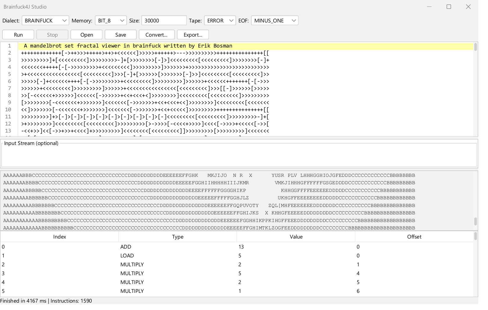
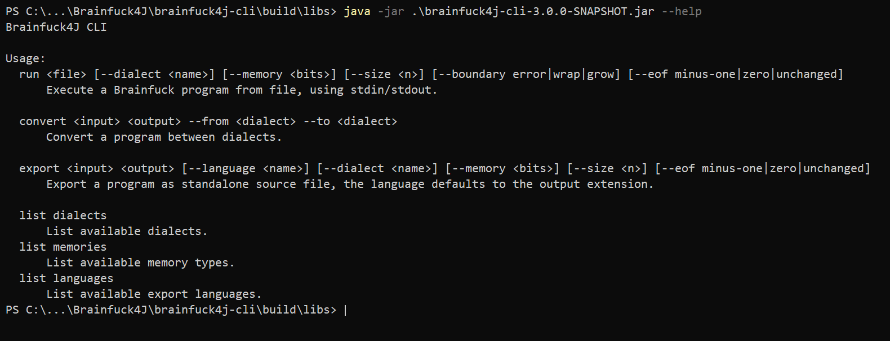

# Brainfuck4J

Fast Java interpreter for Brainfuck language with optimizations, memory management and multi dialect support

## What is Brainfuck?

Brainfuck is an esoteric programming language created in 1993 by Urban Müller. <br>
Notable for its extreme minimalism, the language consists of only eight simple commands, a data pointer and an
instruction pointer. While it is fully Turing complete, it is not intended for practical use, but to challenge and amuse
programmers. Brainfuck requires one to break commands into microscopic steps.

Learn more about Brainfuck [here](https://en.wikipedia.org/wiki/Brainfuck)

## Features

- Fast optimizing interpreter (offset folding of pointer moves, instruction batching, clear/multiplication/scan loops,
  pre-calculated loop points, buffered output)
- Multiple dialects and a dialect converter
- Configurable cell width, tape boundary behavior (error, wrap, grow) and end of input value
- Export of programs as standalone C or Java source files
- Swing-based GUI (Brainfuck Studio)
- Command line interface

## Modules

| Module            | Contents                                                       |
|-------------------|----------------------------------------------------------------|
| `brainfuck4j-lib` | Interpreter and dialects, no dependencies, published to Maven  |
| `brainfuck4j-cli` | Executable command line interface                              |
| `brainfuck4j-app` | Executable Swing GUI                                           |

The CLI and app JARs contain all their dependencies and can be run directly.

## Usage

### GUI

```bash
java -jar brainfuck4j-app-<version>.jar
```



### CLI



Examples:

```bash
# Run a Brainfuck file with defaults (BRAINFUCK dialect, 32-bit cells, 30000 cells), using stdin/stdout
java -jar brainfuck4j-cli-<version>.jar run hello.bf

# Run with explicit dialect and memory settings
java -jar brainfuck4j-cli-<version>.jar run hello.bf --dialect BRAINFUCK --memory 32 --size 60000

# Grow the tape instead of failing on out of bounds access and read 0 at the end of input
java -jar brainfuck4j-cli-<version>.jar run hello.bf --boundary grow --eof zero

# Convert between dialects
java -jar brainfuck4j-cli-<version>.jar convert input.bf output.troll --from BRAINFUCK --to TROLLSCRIPT

# Export as standalone C or Java source, the language is taken from the output extension (or --language)
java -jar brainfuck4j-cli-<version>.jar export hello.bf Hello.java --memory 8
java -jar brainfuck4j-cli-<version>.jar export hello.bf hello.c

# List supported dialects, memory types and export languages
java -jar brainfuck4j-cli-<version>.jar list dialects
java -jar brainfuck4j-cli-<version>.jar list memories
java -jar brainfuck4j-cli-<version>.jar list languages
```

### Use in Gradle

If you want to depend on Brainfuck4J in your own project, use the `brainfuck4j-lib` artifact from the Maven repository here:

https://mvnrepository.com/artifact/de.florianreuth/brainfuck4j-lib

or

https://maven.florianreuth.de/#/snapshots/de/florianreuth/brainfuck4j-lib (for snapshots)

The repository page includes the latest coordinates and setup instructions.

Jar builds can be downloaded from my build server: https://build.florianreuth.de/job/Brainfuck4J/


### Examples

#### Dialects

For accessing multiple dialects, the `DialectType` and `Dialect` classes can be used to convert between dialects or
define your own:

```java
import de.florianreuth.brainfuck4j.dialect.Dialect;
import de.florianreuth.brainfuck4j.dialect.DialectType;

// Convert a Brainfuck program to TrollScript
final String trollScript = DialectType.BRAINFUCK.convert(
        ">++++++[<++++++>-]<.",
        DialectType.TROLLSCRIPT
);

// Create a custom Brainfuck-like dialect
final Dialect customDialect = new Dialect(
        ">", // increment pointer
        "<", // decrement pointer
        "+", // increment cell
        "-", // decrement cell
        "[", // loop start
        "]", // loop end
        ",", // input
        "."  // output
);
final String converted = customDialect.convert("...", DialectType.BRAINFUCK.dialect);
```

#### Execute Brainfuck code (library API)

`Brainfuck4J.compile` turns the (optionally pre-converted) source into a `Program`, which is executed on a `Memory` with
input/output streams:

```java
import de.florianreuth.brainfuck4j.Brainfuck4J;
import de.florianreuth.brainfuck4j.EndOfInput;
import de.florianreuth.brainfuck4j.Memory;
import de.florianreuth.brainfuck4j.MemoryType;
import de.florianreuth.brainfuck4j.Program;
import de.florianreuth.brainfuck4j.TapeBoundary;

import java.io.ByteArrayInputStream;
import java.io.ByteArrayOutputStream;
import java.nio.charset.StandardCharsets;

// Compile once, throws IllegalArgumentException on unbalanced loops
final Program program = Brainfuck4J.compile(">++++++[<++++++>-]<.");

// Choose cell width (BIT_8, BIT_16, BIT_32), size, tape boundary (ERROR, WRAP, GROW) and end of input (MINUS_ONE, ZERO, UNCHANGED)
final Memory memory = new Memory(MemoryType.BIT_32, 30000, TapeBoundary.ERROR, EndOfInput.MINUS_ONE); // or MemoryType.BIT_32.create(30000)

// Execute, throws IndexOutOfBoundsException if the program leaves the memory
final ByteArrayOutputStream out = new ByteArrayOutputStream(); // or System.out
program.execute(memory, new ByteArrayInputStream(new byte[0]), out);

System.out.println("Program output: " + out.toString(StandardCharsets.UTF_8));
System.out.println("Optimized instructions: " + program.instructions().size());
```

#### Internals and classes

- `Brainfuck4J.compile(...)` parses and optimizes the source into a `Program`.
- `Program` is immutable and can be executed repeatedly (also concurrently, each execution with its own `Memory`).
- `Instruction` and `InstructionType` describe the optimized instruction stream (`Program#instructions`).
- `MemoryType` and `Memory` implement the memory model (8/16/32-bit cells, size, pointer state).
- `TapeBoundary` defines out of bounds behavior: `ERROR` (default), `WRAP` (needs more cells than `Program#span`) or `GROW`.
- `EndOfInput` defines the value read at the end of input: `MINUS_ONE` (default), `ZERO` or `UNCHANGED`.
- `ExecutionLimits` optionally bounds loop iterations and memory growth of an execution, which is also interruptible via `Thread#interrupt`.
- `DialectType` and `Dialect` handle multi-dialect support and conversion.
- `ExportLanguage` exports a `Program` as standalone C (unsigned cells, no bounds checks) or Java source file, the end of input behavior is supported, the tape boundary always behaves like `ERROR` (unchecked in C).

All undocumented methods and classes are considered internal implementation details and may change.

## Credits and sources

This program / software was developed with the help of the following resources:

- http://calmerthanyouare.org/2015/01/07/optimizing-brainfuck.html
- http://www.hevanet.com/cristofd/brainfuck/qdb.c
- http://www.hevanet.com/cristofd/brainfuck/
- http://www.clifford.at/bfcpu/

## Contact

- Issues: https://github.com/florianreuth/Brainfuck4J/issues
- Discord: https://florianreuth.de/discord
